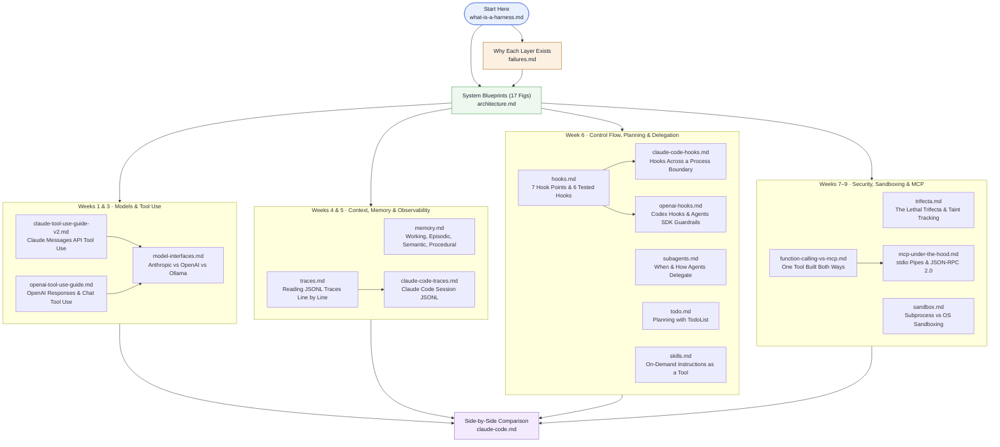

# harnessy Documentation Hub

**[← Repository Home](../README.md)** · **[8-Week Learning Plan](../LEARNING_PLAN.md)** · **[System Architecture](architecture.md)** · **[Failure Gallery](failures.md)**

---

This directory contains **18 deep-dive engineering guides**, **interactive HTML explorers**, and **visual posters** that accompany the 9-week [`lessons/`](../lessons/) curriculum. Every guide is grounded in the reference implementation in `solutions/harnessy/` and compares `harnessy`'s design with production harnesses such as **Claude Code**, **OpenAI Codex**, and the **OpenAI Agents SDK**.

---

## Visual Reading Map

Start with **[What is a harness?](what-is-a-harness.md)** and **[A gallery of failures](failures.md)**, then branch into any domain layer as you work through the weeks:

---

## 1. Foundations & Big Picture (Read Before Week 1)

| Guide | What It Covers | Pairs With |
| --- | --- | --- |
| **[`what-is-a-harness.md`](what-is-a-harness.md)** | The entire harness on one screen with each line tagged by the week that adds it, the five plug-in points, and *loop engineering* vs. *harness engineering*. | Before Week 1 |
| **[`failures.md`](failures.md)** | Eight concrete agent failure modes run twice (`uv run python -m scripts.failure_gallery`): once **without** the harness defense and once **with** it. | All Weeks |
| **[`architecture.md`](architecture.md)** | 17 Mermaid diagrams covering system structure, core dataclasses, runtime sequences, stop-state machines, context compaction, retries, streaming, subagents, safety, evals, and MCP. | All Weeks |
| **[`claude-code.md`](claude-code.md)** | Module-by-module mapping between `harnessy` (~1,400 lines) and Claude Code (loop, tools, `CLAUDE.md`, `/compact`, JSONL transcripts, hooks, permissions, subagents, `/sandbox`, MCP). | After Week 6+ |

---

## 2. Model Interfaces & Tool Use (Weeks 1 & 3)

| Guide | What It Covers | Pairs With |
| --- | --- | --- |
| **[`claude-tool-use-guide-v2.md`](claude-tool-use-guide-v2.md)** | Beginner-to-production guide to Claude tool use: client vs. server tools, `input_schema`, the 6-step lifecycle, parallel tool calls, `is_error`, and `tool_choice`. | [Week 1](../lessons/week1-model-interface.md), [Week 3](../lessons/week3-tools.md) |
| **[`openai-tool-use-guide.md`](openai-tool-use-guide.md)** | OpenAI function calling across both the **Responses API** and **Chat Completions**, strict schemas, `call_id` matching, and a side-by-side table against Claude. | [Week 1](../lessons/week1-model-interface.md), [Week 3](../lessons/week3-tools.md) |
| **[`model-interfaces.md`](model-interfaces.md)** | Every wire-level difference between Anthropic Messages, OpenAI Chat Completions, OpenAI Responses, and Ollama—and how `harnessy/models/` isolates them. | [Week 1](../lessons/week1-model-interface.md) |

---

## 3. Context, Memory & Observability (Weeks 4 & 5)

| Guide | What It Covers | Pairs With |
| --- | --- | --- |
| **[`memory.md`](memory.md)** | The four kinds of agent memory (working, episodic, semantic, procedural), five context-compaction techniques ranked by cost, four long-term store decisions, and six production failure modes. | [Week 4](../lessons/week4-context-and-memory.md) |
| **[`traces.md`](traces.md)** | Three real `harnessy` JSONL traces read line by line (a no-tool answer, a single tool call, and self-verification), plus `jq` recipes for analyzing runs. | [Week 5](../lessons/week5-traces-and-evals.md) |
| **[`claude-code-traces.md`](claude-code-traces.md)** | How Claude Code records session JSONL files under `~/.claude/projects/`, how `parentUuid` and `tool_use_id` link events, and how to inspect them with `jq` and Python. | [Week 5](../lessons/week5-traces-and-evals.md) |

---

## 4. Control Flow, Hooks, Planning & Subagents (Week 6)

| Guide | What It Covers | Pairs With |
| --- | --- | --- |
| **[`hooks.md`](hooks.md)** | All seven hook points (`on_start`, `before_model`, `after_model`, `before_tool`, `after_tool`, `on_stop`, `on_finish`), how hooks chain, and six tested hooks you can copy. | [Week 6](../lessons/week6-control-flow.md) |
| **[`claude-code-hooks.md`](claude-code-hooks.md)** | How Claude Code runs hooks across a process boundary (stdin JSON, exit codes `0`/`2`, stdout decision JSON) with all six `harnessy` hooks ported to shell/Python scripts. | [Week 6](../lessons/week6-control-flow.md) |
| **[`openai-hooks.md`](openai-hooks.md)** | OpenAI's two hook systems—**Codex CLI** (`hooks.json`) and the **OpenAI Agents SDK** (`RunHooks`, `AgentHooks`, tripwire guardrails)—compared in a 4-way matrix. | [Week 6](../lessons/week6-control-flow.md) |
| **[`subagents.md`](subagents.md)** | How the model decides to call `spawn_subagent`, the five levers that control delegation, when subagents hurt vs. help, and six multi-agent patterns. | [Week 6](../lessons/week6-control-flow.md) |
| **[`todo.md`](todo.md)** | How `TodoList` combines a `@tool` with a `before_model` hook so the plan stays at the end of the view without polluting append-only history, illustrated with two real Claude runs. | [Week 6](../lessons/week6-control-flow.md) |
| **[`skills.md`](skills.md)** | How Claude Code skills work (progressive disclosure of `SKILL.md` instructions) and how to add `load_skill` to `harnessy` in 25 lines without changing the loop. | [Week 6](../lessons/week6-control-flow.md) |

---

## 5. Security, Sandboxing & MCP (Weeks 7 & 9)

| Guide | What It Covers | Pairs With |
| --- | --- | --- |
| **[`trifecta.md`](trifecta.md)** | Simon Willison's **lethal trifecta** (`private_data` + `untrusted_input` + `external_send`), step-by-step exfiltration anatomy, why prompt rules fail, `check_trifecta`, and taint-tracking hooks. | [Week 7](../lessons/week7-production.md), [Week 8](../lessons/week8-capstone.md) |
| **[`sandbox.md`](sandbox.md)** | What `run_command` protects against (leaked env keys, orphan child processes, runaway output) vs. what requires OS-level isolation (`sandbox-exec`, Bubblewrap `bwrap`, Docker). | [Week 7](../lessons/week7-production.md) |
| **[`function-calling-vs-mcp.md`](function-calling-vs-mcp.md)** | Why MCP complements function calling rather than replacing it: one `get_weather` tool built both ways, showing every JSON message on both wires. | [Week 9](../lessons/week9-mcp.md) |
| **[`mcp-under-the-hood.md`](mcp-under-the-hood.md)** | Why local MCP uses `stdio` pipes and JSON-RPC 2.0, framing, out-of-order response matching by `id`, stderr logging, and real captured wire traffic. | [Week 9](../lessons/week9-mcp.md) |

---

## 6. Interactive HTML Explorers & Visual Posters

Clone the repository and open these standalone HTML files directly in your browser:

| File | Description |
| --- | --- |
| **[`architecture-archify.html`](architecture-archify.html)** | Interactive system architecture explorer with guided views, search, zoom, trace motion, and dark/light themes (generated from `architecture.archify.json`). |
| **[`anatomy.html`](anatomy.html)** | Interactive "Harness as a Body" explorer mapping every layer to an organ, a second everyday analogy, what breaks without it, and where the metaphor breaks. |
| **[`memory-infographic.html`](memory-infographic.html)** | Interactive visual guide to the four kinds of agent memory, context window compaction, and production failure modes. |
| **[`claude-code-traces-infographic.html`](claude-code-traces-infographic.html)** | Interactive visual map of Claude Code's session JSONL format and record linking. |
