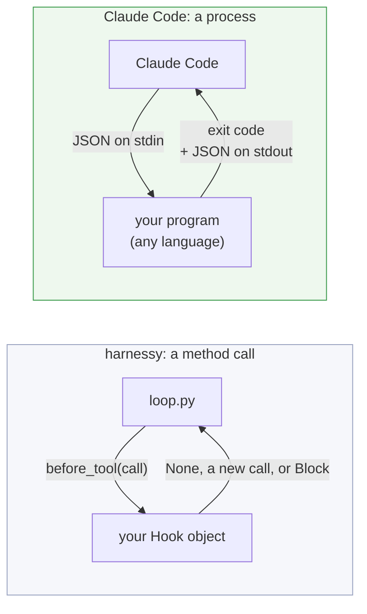
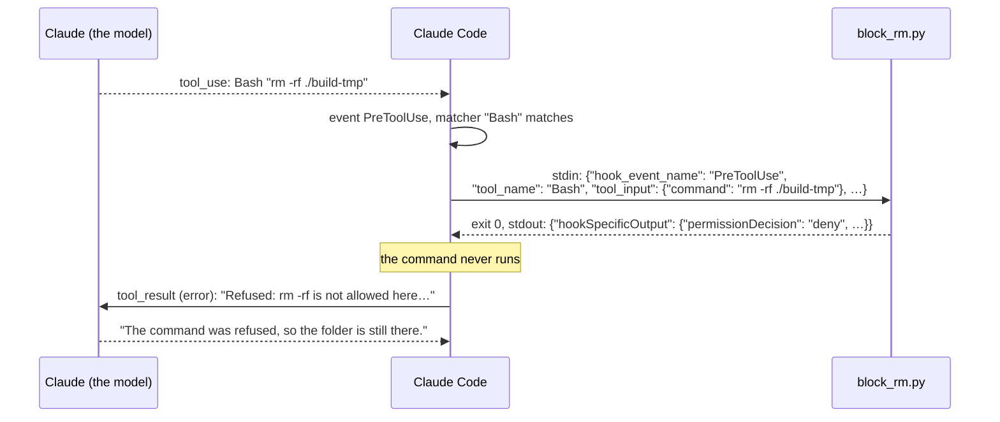
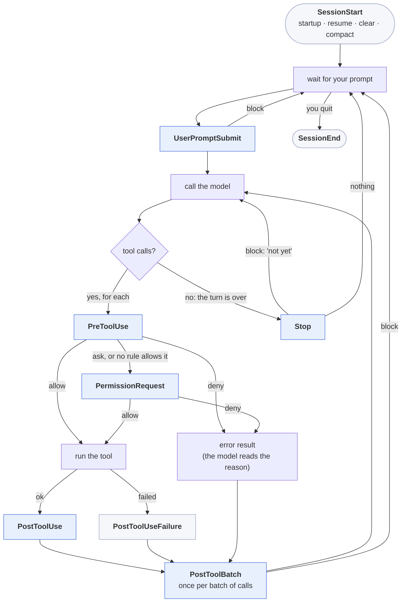
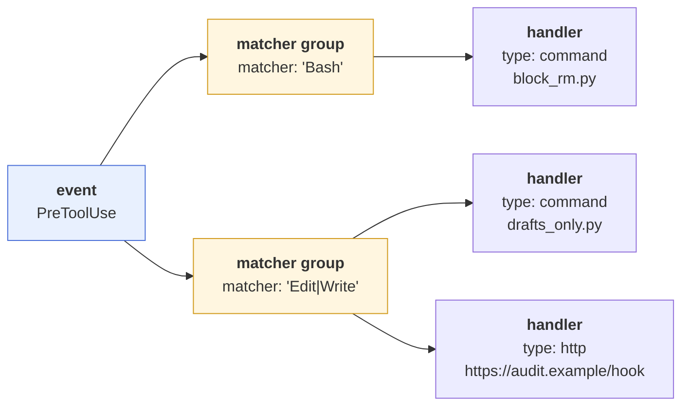
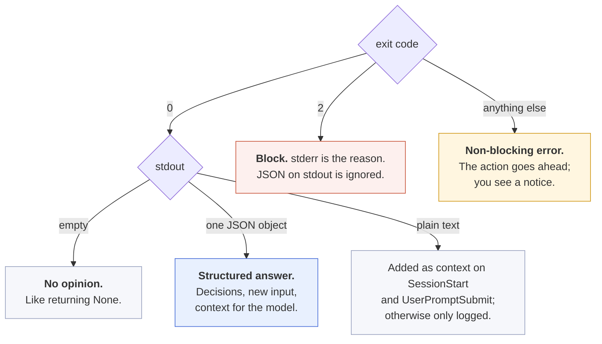
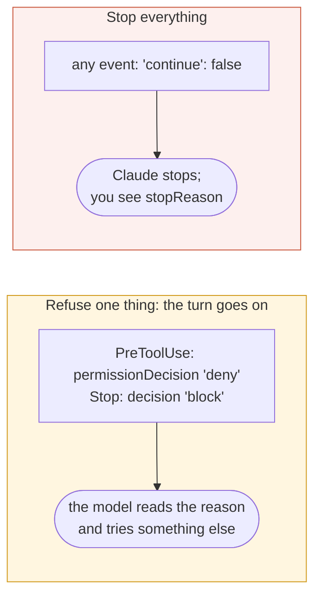
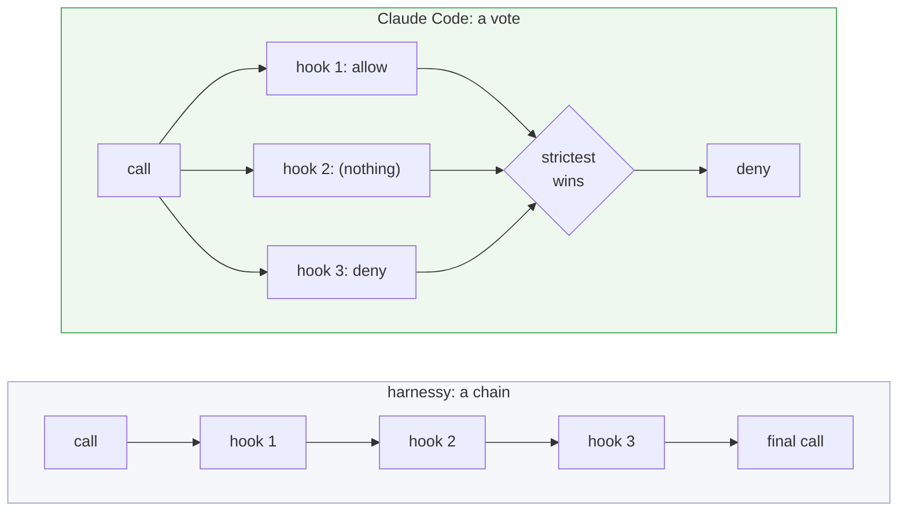
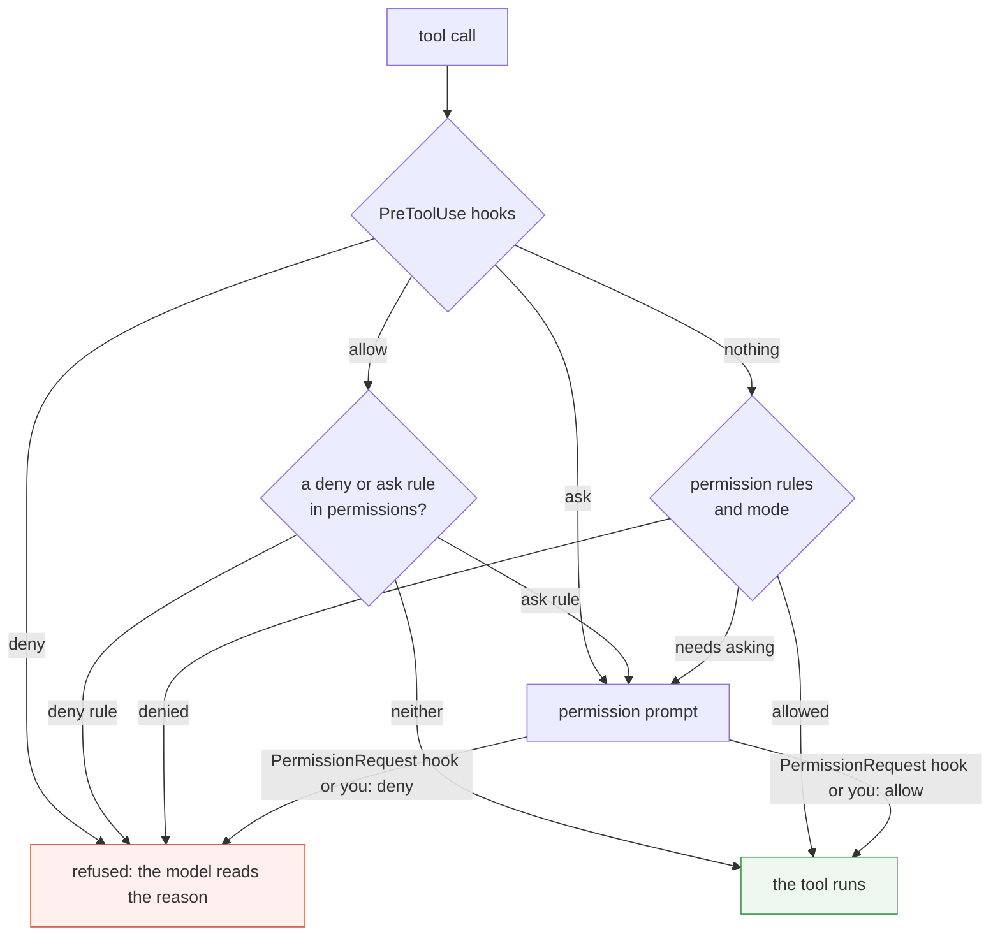
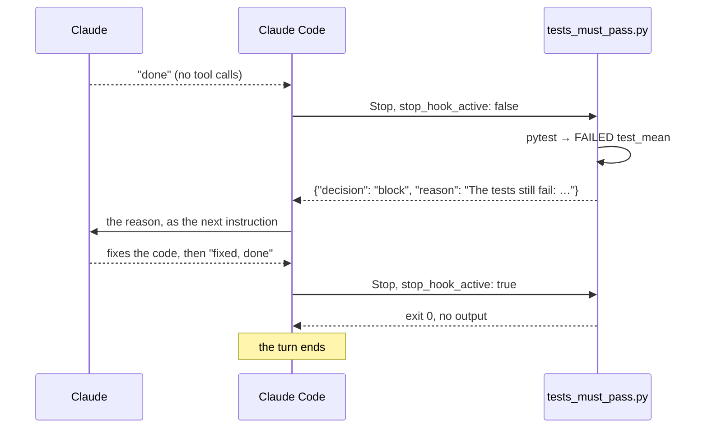
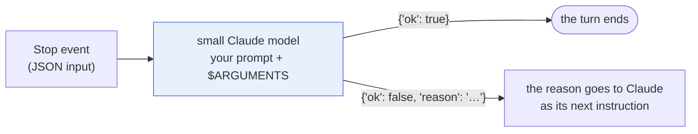

# Claude Code hooks: the same idea, across a process boundary

[`hooks.md`](hooks.md) shows hooks as you build them in week 6: Python classes the loop calls. This page shows the same idea in a harness you use every day. It covers what a Claude Code hook is, where the events fire, how a hook answers, how several hooks combine, and the six harnessy hooks rewritten as Claude Code hooks.

> **In one line:** a Claude Code hook is a **separate program** that Claude Code starts at a fixed point in a session. It reads one JSON object on stdin and answers with an exit code and, optionally, JSON on stdout.

Facts here were checked against Claude Code 2.1.296 and the [official hooks reference](https://code.claude.com/docs/en/hooks). Claude Code changes quickly; when this page and `/hooks` disagree, `/hooks` is right.

## 1. What changes when the hook is a program

In harnessy a hook is an object inside the agent's process, so it can return a Python value. Claude Code can't do that, because your hook may be a shell script, a Python file or an HTTP endpoint. Everything has to cross a process boundary as text.



| | harnessy | Claude Code |
| --- | --- | --- |
| A hook is | a class that inherits from `Hook` | a command, an HTTP endpoint, an MCP tool, or a prompt |
| It is registered | in code: `Agent(hooks=[...])` | in a settings file: `settings.json` |
| It receives | Python objects (`call`, `view`, `result`) | one JSON object on stdin |
| "Change nothing" | return `None` | exit 0 and print nothing |
| "Block" | return `Block("reason")` | exit 2, or print a JSON decision |
| Several hooks | run in order, each feeding the next | run **in parallel**, and the strictest answer wins |
| Hook points | 7 | more than 30 events |

The last two rows are the ones that surprise people, and sections 6 and 3 cover them.

## 2. One hook from end to end

This hook refuses `rm -rf`. It is the Claude Code version of a `before_tool` hook that returns `Block`.

**The script,** `.claude/hooks/block_rm.py`:

```python
#!/usr/bin/env python3
"""PreToolUse on Bash: refuse `rm -rf`. The reason goes back to the model."""
import json, re, sys

event = json.load(sys.stdin)
command = event.get("tool_input", {}).get("command", "")
if re.search(r"\brm\s+-[a-zA-Z]*r[a-zA-Z]*f|\brm\s+-[a-zA-Z]*f[a-zA-Z]*r", command):
    print(json.dumps({"hookSpecificOutput": {
        "hookEventName": "PreToolUse",
        "permissionDecision": "deny",
        "permissionDecisionReason": "Refused: rm -rf is not allowed here. Move files to ./trash/ instead.",
    }}))
sys.exit(0)          # no output = no opinion: the normal permission flow decides
```

**The registration,** `.claude/settings.json`:

```json
{
  "hooks": {
    "PreToolUse": [
      {
        "matcher": "Bash",
        "hooks": [
          { "type": "command", "command": "\"$CLAUDE_PROJECT_DIR\"/.claude/hooks/block_rm.py" }
        ]
      }
    ]
  }
}
```

**What happens at run time:**



This was run for real (`claude -p`, with the settings above). The hook received this on stdin, shortened here:

```json
{
  "session_id": "5d23c7cd-…",
  "transcript_path": "/Users/…/5d23c7cd-….jsonl",
  "cwd": "/private/tmp/…/hk",
  "permission_mode": "default",
  "hook_event_name": "PreToolUse",
  "tool_name": "Bash",
  "tool_input": { "command": "rm -rf ./build-tmp" },
  "tool_use_id": "toolu_01…"
}
```

and Claude's final answer was:

```
The command was refused by a PreToolUse hook with: "Refused: rm -rf is not allowed here.
Move files to ./trash/ instead." so `./build-tmp` was not removed.
```

As in harnessy, a refused tool call isn't a crash. It is a result the model reads and reacts to.

## 3. Where the events fire

Claude Code has more than 30 events. Nine of them sit on the agent loop you wrote in week 2, and those are the ones to learn first.



Blue events can change what happens; grey ones only watch (they can still add context for the model).

One box is missing compared with harnessy's diagram: there is **no event before every model call**. `before_model` fires on every step of the loop. `UserPromptSubmit` fires once per prompt you type, however many model calls follow. Section 7 shows what that costs when you port a hook.

### The nine loop events

| Event | Fires | Matcher filters on | What a hook can do |
| --- | --- | --- | --- |
| `SessionStart` | a session starts or resumes | `startup`, `resume`, `clear`, `compact`, `fork` | Add context (plain stdout works). Can't block. |
| `UserPromptSubmit` | you submit a prompt | no matcher | Block the prompt, or add context to it. |
| `PreToolUse` | before each tool call | tool name | `allow`, `deny`, `ask` or `defer`; rewrite the arguments. |
| `PermissionRequest` | a permission prompt is about to show | tool name | Answer the prompt for you: `allow` or `deny`. |
| `PostToolUse` | after a tool call that worked | tool name | Replace what Claude reads; add context; send a reason. |
| `PostToolUseFailure` | after a tool call that failed | tool name | Add context only. |
| `PostToolBatch` | after all calls of one model response | no matcher | Add context once; stop the loop before the next model call. |
| `Stop` | Claude finishes its answer | no matcher | Turn down "done" with a reason. |
| `SessionEnd` | the session ends | `clear`, `resume`, `logout`, `prompt_input_exit`, `other` | Clean up. Can't block; output is ignored. |

### The rest, by purpose

| Group | Events | Typical use |
| --- | --- | --- |
| Subagents and teams | `SubagentStart`, `SubagentStop`, `TaskCreated`, `TaskCompleted`, `TeammateIdle` | Give a subagent extra rules; refuse its "done", as `Stop` does |
| Context | `PreCompact`, `PostCompact`, `InstructionsLoaded` | Block or log compaction; see which `CLAUDE.md` files loaded |
| Permissions | `PermissionDenied` | Ask for a retry after auto mode denies a call |
| Your screen | `Notification`, `MessageDisplay` | Send a desktop alert when Claude waits for you |
| Environment | `Setup`, `ConfigChange`, `CwdChanged`, `DirectoryAdded`, `FileChanged`, `WorktreeCreate`, `WorktreeRemove` | Reload env vars when `.envrc` changes; audit settings edits |
| Model | `PreModelSwitch`, `PostModelSwitch`, `StopFailure` | Refuse a model switch; log a turn that died on an API error |
| MCP and commands | `Elicitation`, `ElicitationResult`, `UserPromptExpansion` | Answer an MCP server's form from a script |

## 4. Registering a hook

A registration has three levels: the **event**, a **matcher group** that filters when it fires, and one or more **handlers** that run.



### Where the file lives

| Location | Applies to | Shared with the team |
| --- | --- | --- |
| `~/.claude/settings.json` | all your projects | no |
| `.claude/settings.json` | this project | yes, commit it |
| `.claude/settings.local.json` | this project | no, it is gitignored |
| Managed policy settings | the whole organisation | yes, set by an admin |
| A plugin's `hooks/hooks.json` | while the plugin is enabled | yes |
| Skill or subagent frontmatter | while that skill or subagent is active | yes |

Hooks from every level **merge**; a project file doesn't replace your user file. The same handler defined in two settings files runs once. Type `/hooks` in a session to see everything that is registered and where it came from.

### Matchers

- `"*"`, `""` or no matcher: every occurrence of the event.
- Letters, digits, `_`, `-`, spaces, `,` and `|` only: an exact name or a list. `"Edit|Write"` matches either tool.
- Anything else makes it an unanchored JavaScript regular expression. `"mcp__github__.*"` matches every tool of the `github` MCP server.
- A matcher on an event that doesn't support one (`Stop`, `UserPromptSubmit`) is silently ignored.

For tool events, a handler can also carry an `if` field in permission-rule syntax, so the program only starts for the calls you care about: `"if": "Bash(rm *)"`.

### Five kinds of handler

| `type` | What runs | Use it for | Default timeout |
| --- | --- | --- | --- |
| `command` | a shell command, with the event JSON on stdin | almost everything | 600 s |
| `http` | a POST of the event JSON to `url` | a shared audit or policy service | 600 s |
| `mcp_tool` | a tool on an MCP server that is already connected | reusing a check you already expose over MCP | 600 s |
| `prompt` | one call to a small Claude model that answers `{"ok": true}` or `{"ok": false, "reason": "…"}` | judgement calls: "is this command destructive?" | 30 s |
| `agent` | a subagent with tools that investigates, then answers the same way (experimental) | checks that need to read files or run tests | 60 s |

Not every event takes every type. `prompt` and `agent` work on the decision events (`PreToolUse`, `PostToolUse`, `Stop`, `UserPromptSubmit` and a few others); `SessionStart` takes only `command` and `mcp_tool`.

Useful environment variables in a command hook: `CLAUDE_PROJECT_DIR` (the project root, so paths work from any folder) and, in `SessionStart` only, `CLAUDE_ENV_FILE` (write `export` lines to it and later `Bash` calls see them).

## 5. How a hook answers

### What it receives

Every event carries these fields, plus its own:

| Field | Meaning |
| --- | --- |
| `session_id`, `transcript_path` | which session, and its JSONL transcript on disk (the trace from week 5) |
| `cwd` | the working directory |
| `permission_mode` | `default`, `plan`, `acceptEdits`, `auto`, `dontAsk` or `bypassPermissions` |
| `hook_event_name` | the event, so one script can serve several |
| `agent_id`, `agent_type` | present when the event comes from inside a subagent |

Event-specific fields you will use most: `tool_name`, `tool_input` and `tool_use_id` (`PreToolUse`); the same plus `tool_response` and `duration_ms` (`PostToolUse`); `prompt` (`UserPromptSubmit`); `stop_hook_active` and `last_assistant_message` (`Stop`).

### Two ways to answer



**Exit 1 does not block.** A script that crashes with an ordinary error lets the action through. To enforce a rule from the exit code alone, exit with 2. On an event that can't block, exit 2 only shows stderr.

The exit code is the short way. JSON is the precise way, and each event reads different fields:

| Event | To block or refuse | To change something |
| --- | --- | --- |
| `UserPromptSubmit` | `{"decision": "block", "reason": "…"}` | `hookSpecificOutput.additionalContext` |
| `PreToolUse` | `hookSpecificOutput.permissionDecision: "deny"` | `updatedInput` (the whole input object), `additionalContext` |
| `PermissionRequest` | `hookSpecificOutput.decision.behavior: "deny"` | `decision.updatedInput` |
| `PostToolUse` | `{"decision": "block", "reason": "…"}` adds the reason next to the result | `updatedToolOutput` replaces what Claude reads |
| `PostToolBatch` | `{"decision": "block"}` stops the loop | `additionalContext` |
| `Stop`, `SubagentStop` | `{"decision": "block", "reason": "…"}`: the reason becomes Claude's next instruction | – |

Three fields work on any event: `"continue": false` stops Claude entirely (with `stopReason` shown to you), and `systemMessage` shows you a warning. `additionalContext` is capped at 10,000 characters; anything longer is saved to a file and replaced with a preview.

### The two kinds of block, again

harnessy has two meanings of `Block`: in `before_model` it ends the run, in `before_tool` it becomes an error result. Claude Code has the same two, under different names.



## 6. Several hooks: they run in parallel

This is the largest difference from week 6. `HookRunner` runs hooks in list order and hands each one the previous one's result. Claude Code starts every matching hook **at the same time**, gives them all the same input, and then combines the answers.



For `PreToolUse` the order of strength is **`deny` > `defer` > `ask` > `allow`**. Three consequences:

- **Order in the file doesn't matter.** There is no "put the redactor before the tracer" as in `hooks=[RedactSecrets(), approvals, TraceHook(tracer)]`.
- **One hook can't see another's change.** If two hooks both return `updatedInput` for the same call, they did not build on each other. Keep all rewriting for one tool in one hook.
- **A hook can deny, but silence doesn't approve.** A hook that prints nothing leaves the decision to the permission rules.

### Hooks and permission rules together

A hook's `allow` skips the prompt, but it does not switch off your `deny` and `ask` rules in `settings.json`. Those are still checked.



In harnessy terms: `ApprovalHook` is one hook with a policy table. In Claude Code the policy table is the `permissions` block, and hooks are the extra layer for rules a pattern can't express.

## 7. The six harnessy hooks, ported

[`hooks.md`](hooks.md) section 5 has six hooks. Here is each one as a Claude Code hook. Every script below was run with sample JSON on stdin, and the output shown is what came back; example 2's twin, `block_rm.py` in section 2, was also run in a live session.

| harnessy hook | Hook point | Claude Code event | Ports cleanly? |
| --- | --- | --- | --- |
| `RedactSecrets` | `after_tool` | `PostToolUse` + `updatedToolOutput` | Yes |
| `DraftsOnly` | `before_tool` | `PreToolUse` + `updatedInput` or `deny` | Yes |
| `TokenBudget` | `after_model` + `before_model` | – | **No**: no event before each model call |
| `ToolTimer` | `before_tool` + `after_tool` | `PostToolUse` (`duration_ms` is given) | Yes, and shorter |
| `TestsMustPass` | `on_stop` | `Stop` | Yes |
| `Reminder` | `before_model` | `UserPromptSubmit` | Partly: once per prompt, not per call |

### Example 1: Hide secrets in tool output

```python
#!/usr/bin/env python3
"""PostToolUse on Bash: hide secrets in what Claude reads."""
import json, re, sys

SECRET = re.compile(r"(sk-[A-Za-z0-9_-]{20,}|AKIA[0-9A-Z]{16})")
event = json.load(sys.stdin)
response = event.get("tool_response", {})
stdout = response.get("stdout", "")
clean = SECRET.sub("[REDACTED]", stdout)
if clean != stdout:
    print(json.dumps({"hookSpecificOutput": {
        "hookEventName": "PostToolUse",
        "updatedToolOutput": {**response, "stdout": clean},   # same shape as the tool's own output
    }}))
```

```
{"hookSpecificOutput": {"hookEventName": "PostToolUse", "updatedToolOutput":
  {"stdout": "connected with key [REDACTED]", "stderr": "", "interrupted": false, "isImage": false}}}
```

Two limits that the harnessy version doesn't have. `updatedToolOutput` must have the same shape as the tool's real output, and each tool has its own shape, so this script handles `Bash` only. And it changes what **Claude** reads, not what was recorded: the transcript on disk keeps the original. In harnessy, putting `RedactSecrets` before `TraceHook` keeps the secret out of the trace too.

### Example 2: Keep writes inside `drafts/`

```python
#!/usr/bin/env python3
"""PreToolUse on Write: keep new files inside drafts/."""
import json, os, sys

event = json.load(sys.stdin)
tool_input = event["tool_input"]
root = os.path.realpath(event["cwd"])
path = os.path.realpath(tool_input["file_path"])          # Claude Code sends absolute paths

def out(**fields):
    print(json.dumps({"hookSpecificOutput": {"hookEventName": "PreToolUse", **fields}}))

if not path.startswith(root + os.sep):
    out(permissionDecision="deny",
        permissionDecisionReason=f"Refused: {path} is outside the workspace. Use a path under drafts/.")
elif not path.startswith(os.path.join(root, "drafts") + os.sep):
    moved = os.path.join(root, "drafts", os.path.relpath(path, root))
    out(permissionDecision="allow",
        updatedInput={**tool_input, "file_path": moved},   # the WHOLE input, not just the changed field
        additionalContext=f"A hook moved this write to {moved}.")
```

```
notes.md       → permissionDecision: allow, updatedInput.file_path: …/drafts/notes.md
/etc/x         → permissionDecision: deny, "Refused: /private/etc/x is outside the workspace. …"
drafts/a.md    → (no output: the normal permission flow decides)
```

`updatedInput` **replaces** the input object, so copy the fields you aren't changing; `replace(call, arguments={**call.arguments, …})` does the same in harnessy. Note that `allow` here also skips the permission prompt for that write. If you want the rewrite without the auto-approval, return `"ask"` instead.

### Example 3: A token budget (does not port)

`TokenBudget` counts in `after_model` and blocks in `before_model`. Claude Code has neither point, and the hook input has no token count. What you can do instead:

- For a hard cap in scripts, use the harness's own limit: `claude -p --max-budget-usd 2`. This is the equivalent of harnessy's `max_cost_usd` from week 7.
- For a cap on tool activity, count calls in a `PostToolBatch` hook and return `{"continue": false, "stopReason": "…"}` when the count passes your limit.

The lesson from week 6 still holds: a limit that the loop doesn't expose a hook point for has to live in the loop.

### Example 4: Find slow tools

```python
#!/usr/bin/env python3
"""PostToolUse on everything: log how long each tool took."""
import json, sys

event = json.load(sys.stdin)
with open(f"{event['cwd']}/tool-times.log", "a") as log:
    log.write(f"{event['tool_name']}: {event.get('duration_ms', 0) / 1000:.2f}s\n")
```

```
Read: 0.01s
```

The harnessy version needs two hook points and a stored start time. Here the harness has already measured it. Register it with no matcher so it sees every tool, and add `"async": true` so logging never slows Claude down.

### Example 5: "Run the tests before you say done"

```python
#!/usr/bin/env python3
"""Stop: turn down "done" while the tests fail."""
import json, subprocess, sys

event = json.load(sys.stdin)
if event.get("stop_hook_active"):        # already continuing because of a Stop hook: let it end
    sys.exit(0)
run = subprocess.run(["uv", "run", "pytest", "-q"], capture_output=True, text=True, cwd=event["cwd"])
if run.returncode != 0:
    print(json.dumps({"decision": "block",
                      "reason": f"The tests still fail:\n{run.stdout[-1500:]}\nFix them before finishing."}))
```



The `stop_hook_active` check is this hook's `max_rejections`. With it, the hook rejects once and then lets Claude finish. Without it, Claude Code's own cap applies: 8 blocks in a row, counted from the last tool call. harnessy's `StopCheck` defaults to 2.

### Example 6: Add a reminder

No script needed. On `UserPromptSubmit`, plain stdout is added to the context:

```json
{
  "hooks": {
    "UserPromptSubmit": [
      { "hooks": [ { "type": "command", "command": "echo 'Answer in British English.'" } ] }
    ]
  }
}
```

This is `Reminder` with one difference: it is added once per prompt, where `before_model` adds it to every model call. For a rule that must hold on every call, `CLAUDE.md` is the better home, since it is in the system prompt on every call.

### All of them registered

```json
{
  "hooks": {
    "PreToolUse": [
      { "matcher": "Bash",  "hooks": [ { "type": "command", "command": "\"$CLAUDE_PROJECT_DIR\"/.claude/hooks/block_rm.py" } ] },
      { "matcher": "Write", "hooks": [ { "type": "command", "command": "\"$CLAUDE_PROJECT_DIR\"/.claude/hooks/drafts_only.py" } ] }
    ],
    "PostToolUse": [
      { "matcher": "Bash", "hooks": [ { "type": "command", "command": "\"$CLAUDE_PROJECT_DIR\"/.claude/hooks/redact.py" } ] },
      { "hooks": [ { "type": "command", "command": "\"$CLAUDE_PROJECT_DIR\"/.claude/hooks/tool_timer.py", "async": true } ] }
    ],
    "Stop": [
      { "hooks": [ { "type": "command", "command": "\"$CLAUDE_PROJECT_DIR\"/.claude/hooks/tests_must_pass.py", "timeout": 300 } ] }
    ],
    "UserPromptSubmit": [
      { "hooks": [ { "type": "command", "command": "echo 'Answer in British English.'" } ] }
    ]
  }
}
```

## 8. Hooks that think: `prompt` and `agent`

Every hook so far is a rule written in code. Some rules are judgement calls: "has Claude really finished everything the user asked for?" For those, a handler can be a prompt.

```json
{
  "hooks": {
    "Stop": [
      { "hooks": [ {
          "type": "prompt",
          "prompt": "Evaluate if Claude should stop: $ARGUMENTS. Check if all tasks are complete."
      } ] }
    ]
  }
}
```



- A **`prompt`** hook is one model call. It sees only the event JSON.
- An **`agent`** hook is a subagent that can read files and search the code before it answers (up to 50 turns, experimental).

The trade-off is the one from week 5's LLM grader: a code check is cheap, fast and gives the same answer every time; a model check handles what code can't express, but it costs tokens on every event and can be wrong. Use code where a rule can be written as code.

## 9. Background hooks

A command hook normally makes Claude wait. Add `"async": true` and Claude carries on while the hook runs.

| | Normal hook | `"async": true` |
| --- | --- | --- |
| Claude waits for it | yes | no |
| Can block or change the action | yes | no, the action has already happened |
| Output | used immediately | `additionalContext` reaches Claude on the next turn |
| Good for | guards, rewrites, stop checks | logging, notifications, a slow test run after each edit |

## 10. Safety and debugging

**A command hook runs with your full user permissions.** It is not inside the sandbox from week 7, and it can read and delete anything you can. So:

- **Read a project's `.claude/settings.json` before you trust the folder.** In an interactive session, hooks wait until you accept the trust dialog. With `claude -p` there is no dialog: hooks committed in the repository run straight away. For a repository you didn't write, run with `--settings '{"disableAllHooks": true}'`.
- **Treat the input as untrusted.** `tool_input` was written by a model that may have read an injected web page ([`trifecta.md`](trifecta.md)). Quote shell variables (`"$VAR"`), check paths for `..`, and prefer parsing JSON in Python over splicing it into a shell command.
- **A crash is not a block.** A guard that exits 1 on a bug lets everything through. Test the failure path, or set `"onFailure": "block"` on the handler.

When a hook doesn't fire:

| Check | How |
| --- | --- |
| Is it registered? | `/hooks` lists every hook and its source file |
| Does the matcher match? | Tool names are case-sensitive: `Bash`, not `bash`. MCP tools are `mcp__<server>__<tool>` |
| Does the script work alone? | `echo '{"tool_name":"Bash","tool_input":{"command":"rm -rf x"}}' \| .claude/hooks/block_rm.py` |
| What did Claude Code see? | `claude --debug`, then read `~/.claude/debug/<session-id>.txt` for `Hooks:` lines with status and duration |
| Is it executable? | `chmod +x`, and a `#!` first line |

Testing the script alone with JSON on stdin is this page's `ScriptedModel`: no tokens, milliseconds, and it is how every example above was checked.

## See also

- [`hooks.md`](hooks.md): the harnessy hooks these are ported from, and how to write and test your own
- [`openai-hooks.md`](openai-hooks.md): the same for OpenAI, in Codex and in the Agents SDK, with a three-way comparison
- [`claude-code.md`](claude-code.md): every other harnessy module mapped onto Claude Code
- [`sandbox.md`](sandbox.md) and [`trifecta.md`](trifecta.md): what hooks can and can't protect you from
- The official [hooks reference](https://code.claude.com/docs/en/hooks) and [hooks guide](https://code.claude.com/docs/en/hooks-guide)
