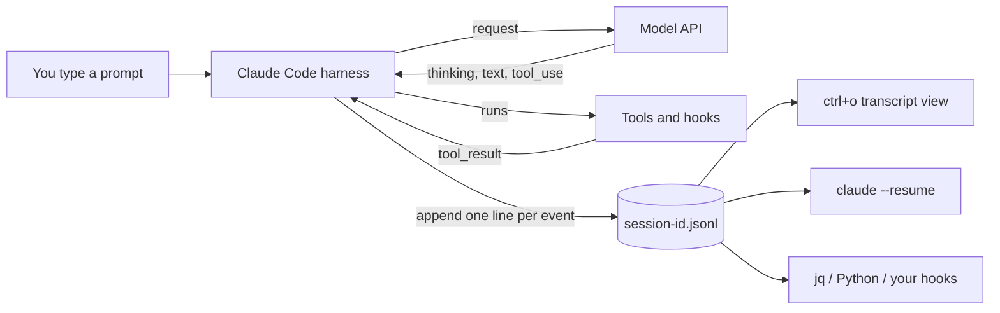
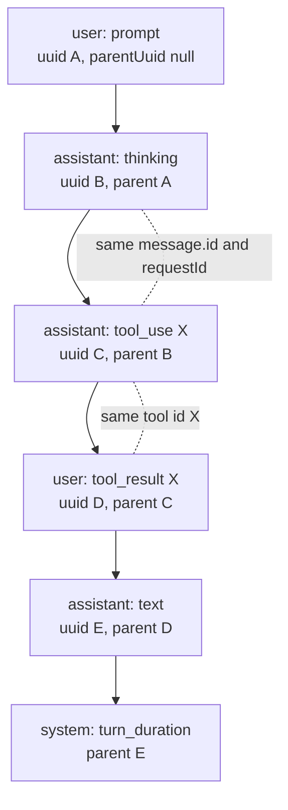

# Traces in Claude Code: the session JSONL and how to read it

**[← Docs Hub](README.md)** · **[harnessy Traces](traces.md)** · **[Claude Code Overview](claude-code.md)** · **[Claude Code Hooks](claude-code-hooks.md)** · **[Week 5 Lesson](../lessons/week5-traces-and-evals.md)**

---

[`traces.md`](traces.md) shows how harnessy writes its own trace. This page
shows the same idea in Claude Code: what it records, where the file lives,
how the lines link together, and how to read them with `jq` and a few lines
of Python.

Everything here was checked against a real session file written by Claude
Code 2.1.296. The field names are not a published, stable format, so treat
them as "what the file looks like today" and expect small changes between
versions. The OpenTelemetry section is from the documentation only.


*The whole page in one picture. One simplification: `tool-results/` and
`subagents/` are drawn directly under `<project>/`, but they sit one level
deeper, in a `<session-id>/` folder next to the `.jsonl` (section 2).*

## 1. The idea in one picture

Claude Code keeps one append-only file per session. Every prompt, model
reply, tool call, tool result and hook run becomes one JSON object on its
own line (JSONL).



The file has two jobs. It is the **memory** that lets `claude --resume`
rebuild a conversation, and it is the **trace** you read afterwards to see
what happened, how long it took and what it cost.

## 2. Where the files live

```
~/.claude/
├── history.jsonl                  # every prompt you typed, across all projects
├── projects/
│   └── -Users-you-code-myrepo/    # the start directory, "/" replaced by "-"
│       ├── <session-id>.jsonl     # the transcript (the trace)
│       └── <session-id>/
│           ├── tool-results/      # large tool outputs kept out of the JSONL
│           └── subagents/         # agent-<id>.jsonl + agent-<id>.meta.json
└── file-history/<session-id>/     # file backups taken before edits (/rewind)
```

Three things to know:

- **The project folder is named after the directory where the session
  started.** Start Claude Code in `myrepo/` and in `myrepo/docs/` and you
  get two folders.
- **`history.jsonl` is not the trace.** It holds only what you typed: one
  line per prompt with `display`, `timestamp`, `project` and `sessionId`.
  It is useful for finding which session a prompt belongs to.
- **Old sessions are deleted.** The retention period is the
  `cleanupPeriodDays` setting (30 days by default, per the docs). Copy a
  transcript somewhere else if you want to keep it.

## 3. One line, up close

Each conversation record is the raw API message wrapped in an envelope that
says where and when it happened:

```json
{
  "type": "assistant",
  "uuid": "e93db147-6404-43aa-b475-a50824751dd0",
  "parentUuid": "9b3c31a4-f707-4b78-b72f-b386f3ce006e",
  "timestamp": "2026-10-11T14:24:49.026Z",
  "sessionId": "47236cd0-8e4b-47c3-b64d-efd37ac51d0e",
  "cwd": "/Users/you/code/myrepo",
  "gitBranch": "main",
  "version": "2.1.296",
  "isSidechain": false,
  "requestId": "req_011Cfvbv2GQmddcHXuYPEauc",
  "message": {
    "id": "msg_011Cfvbv39jvqcoKeb5LJNuV",
    "model": "claude-opus-5-5",
    "role": "assistant",
    "content": [
      {"type": "tool_use", "id": "toolu_018FM2wD…", "name": "Skill",
       "input": {"skill": "task-observer"}}
    ],
    "stop_reason": "tool_use",
    "usage": {
      "input_tokens": 2,
      "cache_creation_input_tokens": 59096,
      "cache_read_input_tokens": 23526,
      "output_tokens": 284
    }
  }
}
```

| Field | What it tells you |
|---|---|
| `type` | The kind of record (section 4). |
| `uuid` / `parentUuid` | This record's id and the record before it. This is the chain. |
| `timestamp` | When the line was written, in UTC. |
| `sessionId`, `cwd`, `gitBranch`, `version` | Where the work happened and which Claude Code wrote it. |
| `isSidechain` | `true` for subagent records. |
| `message` | The API message exactly as sent or received: `role`, `content`, and on assistant lines `model`, `stop_reason` and `usage`. |
| `requestId` | The API request this line came from. |

The matching tool result is a `user` record, because that is how tool
results go back to the model:

```json
{
  "type": "user",
  "uuid": "28ce1254-124b-496c-8056-59d09d9cfec4",
  "parentUuid": "e93db147-6404-43aa-b475-a50824751dd0",
  "timestamp": "2026-10-11T14:24:49.067Z",
  "message": {
    "role": "user",
    "content": [
      {"type": "tool_result", "tool_use_id": "toolu_018FM2wD…",
       "content": "Launching skill: task-observer"}
    ]
  },
  "toolUseResult": {"success": true, "commandName": "task-observer"},
  "permissionDecision": {"decision": "accept", "source": "config"}
}
```

`toolUseResult` is the structured result the harness kept for itself
(`message.content` is the text the model saw). `permissionDecision` records
whether the call was allowed and why.

## 4. The record types

| `type` | What it records |
|---|---|
| `user` | Your prompt (`content` is a string) **or** a tool result (`content` is a list holding `tool_result` blocks). |
| `assistant` | One content block of a model reply: `thinking`, `text` or `tool_use`. |
| `system` | Harness events, told apart by `subtype` (table below). |
| `attachment` | Context the harness added, including every hook run with its command, stdout, stderr, exit code and duration. |
| `file-history-snapshot`, `file-history-delta` | Pointers to the file backups behind `/rewind`. |
| `ai-title`, `last-prompt`, `mode`, `permission-mode` | Session bookkeeping. These have no `uuid` and are not part of the conversation. |

`system` subtypes seen in a normal session:

| `subtype` | What it records |
|---|---|
| `turn_duration` | How long a whole turn took (`durationMs`) and the message count so far. |
| `stop_hook_summary` | Which Stop hooks ran, their errors, and whether one kept Claude working. |
| `compact_boundary` | A compaction: trigger, tokens before and after, how long it took. |
| `local_command` | A slash command you ran, such as `/context`. |
| `away_summary` | The short recap shown when you come back to a session. |

Some `user` lines are not things you typed. Lines with `"isMeta": true`
were injected by the harness (slash command output, for example). Filter
them out when you want only real prompts.

## 5. How the lines connect

A flat list of events is a log. Two links turn it into a trace.



- **`parentUuid` is the chain.** Each record points at the one before it.
  Follow the pointers backwards from any line and you get the exact
  conversation the model saw at that moment.
- **`tool_use.id` pairs with `tool_result.tool_use_id`.** This joins a
  call to its output. The gap between the two timestamps is how long the
  tool took.
- **One API response becomes several lines.** Each content block gets its
  own line. They share `message.id` and `requestId`, and each repeats the
  same `usage`. Count usage once per `message.id`, not once per line.
- **Compaction starts a new root.** A `compact_boundary` record has
  `parentUuid: null` and a `logicalParentUuid` that points at the old
  chain. The old lines stay in the file; the model just no longer sees them.
- **Subagents are separate files.** Their records live in
  `subagents/agent-<id>.jsonl`, marked `isSidechain: true`. The
  `.meta.json` beside each one holds the agent type, its description and
  the `toolUseId` of the call that started it, which is how you join it
  back to the parent transcript.
- **Resume and rewind make a tree.** A new record can point at an older
  parent, so one file can hold several branches. `last-prompt.leafUuid`
  marks the tip that is currently live.

## 6. Reading it inside Claude Code

| What | How |
|---|---|
| See the full transcript of the current session | `ctrl+o` |
| Reopen an old session | `claude --resume` (pick from a list) or `claude --continue` (most recent) |
| Save a readable copy | `/export` |
| Check context size right now | `/context` |
| Undo edits back to an earlier prompt | `/rewind` |

## 7. Reading it with jq

Set the file once. The newest transcript for a project is the most recently
modified `.jsonl` in its folder:

```bash
F=$(ls -t ~/.claude/projects/-Users-you-code-myrepo/*.jsonl | head -1)
```

Every query below was run against a real session; the output shown is from
that run.

**Your prompts, in order**

```bash
jq -r 'select(.type=="user" and (.message.content|type)=="string" and (.isMeta|not))
       | "\(.timestamp)  \(.message.content[0:60])"' "$F"
```

```
2026-10-11T14:24:40.077Z  i want you to create hook doc specific to claude code and on
2026-10-11T14:41:40.888Z  push these doc changes
2026-10-12T13:05:05.846Z  copy the same docs to harness-cli too
```

**Which tools were called, and how often**

```bash
jq -r 'select(.type=="assistant") | .message.content[]
       | select(.type=="tool_use") | .name' "$F" | sort | uniq -c | sort -rn
```

```
  31 Bash
   7 WebFetch
   3 Read
   2 Write
```

**How long each turn took**

```bash
jq -r 'select(.type=="system" and .subtype=="turn_duration")
       | "\(.timestamp)  \(.durationMs/1000|floor)s  \(.messageCount) messages"' "$F"
```

```
2026-10-11T14:35:52.571Z  672s  156 messages
2026-10-11T14:41:54.870Z  14s  166 messages
2026-10-12T13:05:34.342Z  28s  180 messages
```

**Tool calls that failed**

```bash
jq -r 'select(.type=="user") | .message.content | arrays | .[]
       | select(.type=="tool_result" and .is_error==true)
       | .content | tostring | .[0:80]' "$F"
```

**Hook runs, with exit code and duration**

```bash
jq -r 'select(.type=="attachment" and .attachment.type=="hook_success")
       | .attachment | "\(.hookName)  exit=\(.exitCode)  \(.durationMs)ms"' "$F"
```

```
SessionStart:startup  exit=0  372ms
SessionStart:compact  exit=0  97ms
```

**Compactions, with tokens before and after**

```bash
jq -c 'select(.type=="system" and .subtype=="compact_boundary")
       | .compactMetadata | {trigger, preTokens, postTokens}' "$F"
```

```
{"trigger":"manual","preTokens":216199,"postTokens":15486}
```

**Permission decisions**

```bash
jq -c 'select(.type=="user" and .permissionDecision) | .permissionDecision' "$F" \
  | sort | uniq -c
```

## 8. Reading it with Python

### A timeline with tool latency

This joins each `tool_use` to its `tool_result` by id and prints the gap.

```python
#!/usr/bin/env python3
"""Print a session as a timeline: prompts, tool calls with latency, replies."""
import json, sys
from datetime import datetime

def ts(rec):
    return datetime.fromisoformat(rec["timestamp"].replace("Z", "+00:00"))

calls = {}  # tool_use id -> (name, start time)
for line in open(sys.argv[1]):
    rec = json.loads(line)
    if rec.get("type") not in ("user", "assistant") or rec.get("isMeta"):
        continue
    content = rec["message"]["content"]
    clock = ts(rec).strftime("%H:%M:%S")
    if isinstance(content, str):
        print(f"{clock}  YOU     {content[:70]!r}")
        continue
    for block in content:
        kind = block.get("type")
        if kind == "tool_use":
            calls[block["id"]] = (block["name"], ts(rec))
        elif kind == "tool_result":
            name, started = calls.pop(block["tool_use_id"], ("?", ts(rec)))
            took = (ts(rec) - started).total_seconds()
            flag = "  ERROR" if block.get("is_error") else ""
            print(f"{clock}  TOOL    {name:<10} {took:6.1f}s{flag}")
        elif kind == "text" and rec["type"] == "assistant":
            print(f"{clock}  CLAUDE  {block['text'][:70]!r}")
```

```
$ python3 timeline.py "$F"
14:24:40  YOU     'i want you to create hook doc specific to claude code and one for open'
14:24:49  TOOL    Skill         0.0s
14:25:00  TOOL    Bash          3.0s
14:28:03  CLAUDE  'Example scripts pass their stdin tests and the Agents SDK samples ran '
14:28:09  TOOL    Bash          0.5s  ERROR
14:28:35  TOOL    Bash         21.9s
14:31:16  TOOL    Write         2.7s
```

The latency includes any time spent waiting for a permission prompt, so a
slow line may be you, not the tool.

### Token totals, counted once per response

```python
#!/usr/bin/env python3
"""Total token usage for a session, counting each API response once."""
import json, sys

usage = {}  # message id -> usage; later lines of the same response overwrite
for line in open(sys.argv[1]):
    rec = json.loads(line)
    if rec.get("type") == "assistant":
        usage[rec["message"]["id"]] = rec["message"]["usage"]

print(f"API responses: {len(usage)}")
for key in ("input_tokens", "cache_creation_input_tokens",
            "cache_read_input_tokens", "output_tokens"):
    print(f"{key:<30} {sum(u.get(key, 0) for u in usage.values()):>12,}")
```

```
$ python3 tokens.py "$F"
API responses: 41
input_tokens                             90
cache_creation_input_tokens         419,541
cache_read_input_tokens           6,261,751
output_tokens                        64,275
```

Summing `usage` over every line instead gave 168,200 output tokens for the
same session, more than twice the real figure. That is the
one-response-many-lines rule from section 5.

Subagent tokens are not in this total. They are in the files under
`subagents/`; run the script on each of those and add the results.

## 9. Reading it live from a hook

Every hook receives `transcript_path` in its stdin JSON
([`claude-code-hooks.md`](claude-code-hooks.md), section 2), so a hook can
read the trace while the session is still running. This Stop hook appends
one line per turn to a log of your own:

```python
#!/usr/bin/env python3
"""Stop hook: append one line per turn to ~/claude-turns.log."""
import collections, json, os, sys

event = json.load(sys.stdin)
tools = collections.Counter()
for line in open(event["transcript_path"]):
    rec = json.loads(line)
    if rec.get("type") == "assistant":
        for block in rec["message"]["content"]:
            if block.get("type") == "tool_use":
                tools[block["name"]] += 1

with open(os.path.expanduser("~/claude-turns.log"), "a") as out:
    out.write(json.dumps({"session": event["session_id"],
                          "tool_calls_so_far": dict(tools)}) + "\n")
```

```json
{
  "hooks": {
    "Stop": [
      {"hooks": [{"type": "command", "command": "python3 ~/.claude/hooks/log_session.py"}]}
    ]
  }
}
```

The script was tested by piping a `transcript_path` into it by hand, not by
registering it in a live session. The most recent lines may not be on disk
yet when a hook reads the file, so use it for summaries, not for decisions
that need the very last event.

## 10. Other ways to observe a session

The JSONL is a local record you read after the fact. Three other channels
exist for watching live:

| Channel | What you get | When to use it |
|---|---|---|
| Hooks | Your code runs at each event with the event's JSON on stdin | Custom logging, forwarding events, enforcing rules |
| `claude --debug` | The harness's own log: hook matching, tool dispatch, errors | Finding out why a hook or tool did not fire |
| OpenTelemetry | Metrics (tokens, cost, sessions) and events (prompts, tool results, API requests) sent to a collector | Team dashboards and cost tracking across many machines |

OpenTelemetry is off by default. It is turned on with
`CLAUDE_CODE_ENABLE_TELEMETRY=1` plus the standard `OTEL_*` exporter
variables, and prompt text is left out unless you opt in. This section is
from the documentation and was not run here.

## 11. Things to be careful about

- **Transcripts hold secrets.** Anything a tool printed is in the file in
  plain text, including an API key from `env` or the contents of a `.env`
  file Claude read. Do not share a transcript without checking it.
- **The file grows fast.** A long session reaches tens of megabytes. Use
  `jq` line by line as above; `jq -s` loads the whole file into memory.
- **A line can be half-written** if you read while Claude Code is writing.
  Wrap `json.loads` in a `try` when tailing a live session.
- **The format is internal.** Field names here match 2.1.296. Write readers
  that use `.get()` and ignore record types they do not know.

## See also

- [`traces.md`](traces.md): harnessy's own trace format
- [`claude-code-hooks.md`](claude-code-hooks.md): the events that produce
  the `attachment` records
- [`claude-code.md`](claude-code.md): how the pieces of harnessy map onto
  Claude Code
