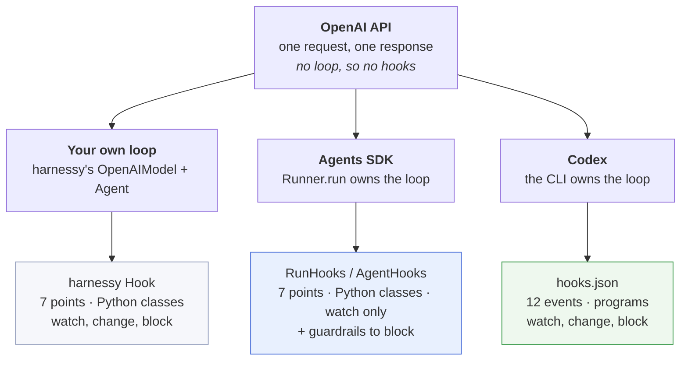
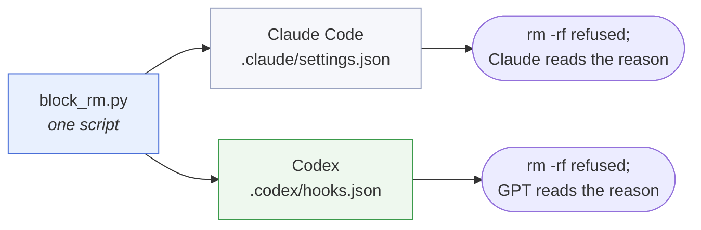
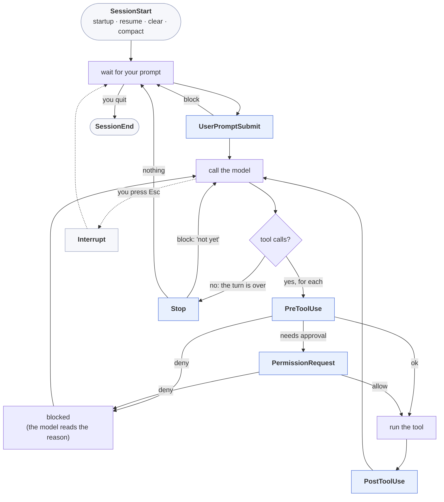
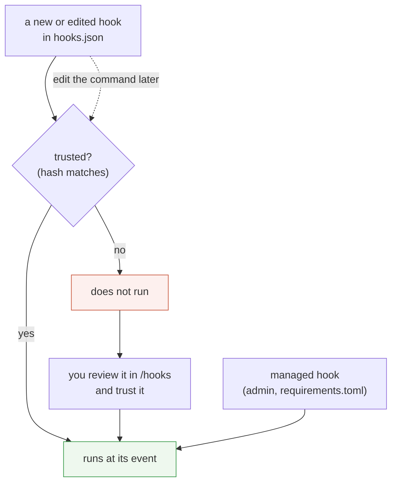
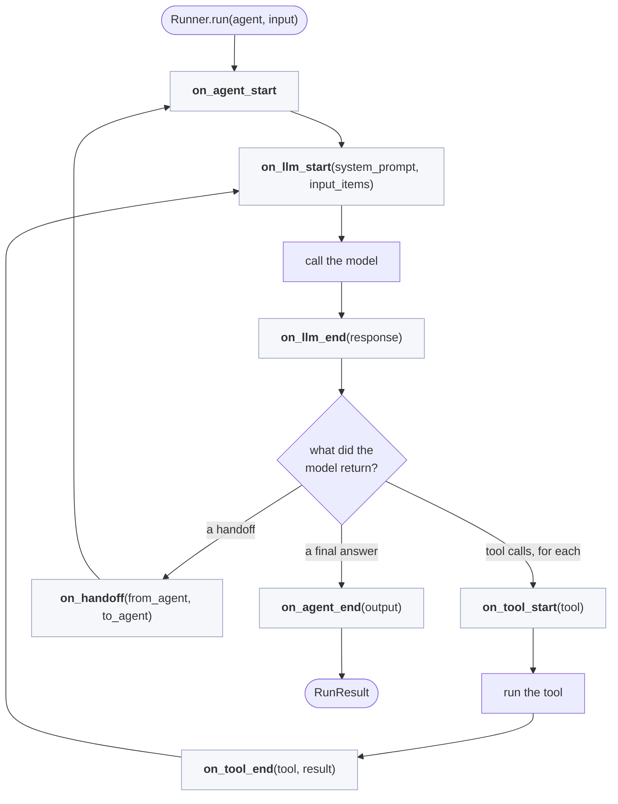
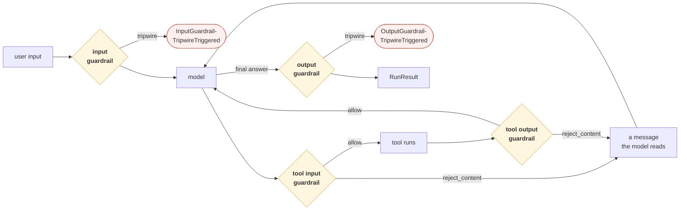
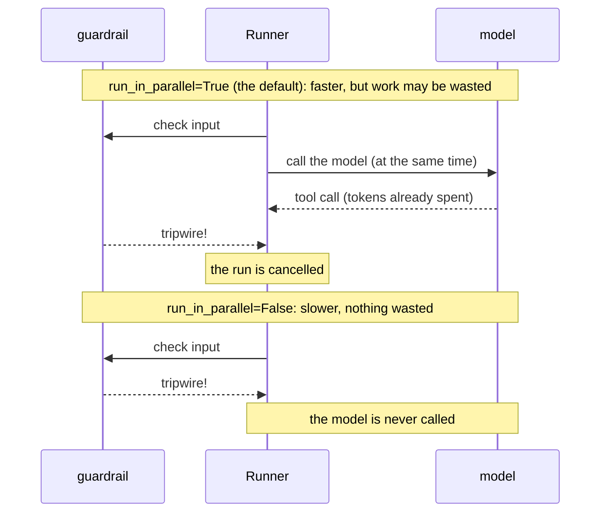
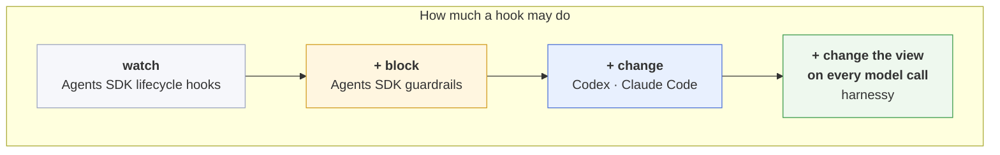

# OpenAI hooks: Codex and the Agents SDK

This is the OpenAI companion to [`claude-code-hooks.md`](claude-code-hooks.md). OpenAI has hooks in two places, and they look nothing alike: **Codex** (a coding agent you run in a terminal) uses programs set in a config file, and the **Agents SDK** (a Python library) uses classes. This page covers both, maps each onto harnessy's week 6 hooks, and ends with a three-way comparison.

> **In one line:** hooks belong to the harness, not to the model API. Codex's hooks are Claude Code's hooks with small differences; the Agents SDK splits harnessy's `Hook` in two, **lifecycle hooks that only watch** and **guardrails that can block**.

Facts here were checked against Codex CLI 0.162.1, `openai-agents` 0.23.1, and the official [Codex hooks](https://developers.openai.com/codex/hooks) and [Agents SDK](https://openai.github.io/openai-agents-python/) docs. Every code sample in Part B was run, and the output shown is what came back.

## 1. Where the hooks are

The OpenAI API itself (`/v1/responses`, `/v1/chat/completions`) has no hooks. It answers one request and forgets you; the loop is your code ([`openai-tool-use-guide.md`](openai-tool-use-guide.md), section 6). Hooks appear only when someone else owns the loop.



| You are… | Read |
| --- | --- |
| using Codex in a terminal and want to guard or extend it | Part A |
| writing a Python agent with the Agents SDK | Part B |
| calling the API from your own loop | [`hooks.md`](hooks.md): you write the hook points yourself |

---

# Part A: Codex hooks

## 2. The same contract as Claude Code

A Codex hook is a program. Codex starts it at a fixed event, sends one JSON object on stdin, and reads the exit code and stdout. The field names match Claude Code's on purpose, so a simple hook script runs in both.

This is `block_rm.py` from [`claude-code-hooks.md`](claude-code-hooks.md) section 2, **unchanged**, registered in `.codex/hooks.json`:

```json
{
  "hooks": {
    "PreToolUse": [
      {
        "matcher": "Bash",
        "hooks": [
          { "type": "command", "command": "/usr/bin/python3 \"$(git rev-parse --show-toplevel)/.codex/hooks/block_rm.py\"" }
        ]
      }
    ]
  }
}
```

A real run (`codex exec "Run exactly this shell command once: rm -rf ./build-tmp …"`) printed:

```
hook: PreToolUse
ERROR codex_core::tools::router: error=Command blocked by PreToolUse hook: Refused: rm -rf is not
  allowed here. Move files to ./trash/ instead.. Command: rm -rf ./build-tmp
hook: PreToolUse Blocked
codex
The command was refused: "Refused: rm -rf is not allowed here. Move files to ./trash/ instead."
```

and the hook had received:

```json
{
  "session_id": "01a12b5d-…",
  "turn_id": "01a12b5d-…",
  "transcript_path": "/Users/…/.codex/sessions/2026/10/11/rollout-….jsonl",
  "cwd": "/private/tmp/…/hk",
  "hook_event_name": "PreToolUse",
  "model": "gpt-5.6-terra",
  "permission_mode": "bypassPermissions",
  "tool_name": "Bash",
  "tool_input": { "command": "rm -rf ./build-tmp" },
  "tool_use_id": "exec-60fa3163-…"
}
```



Two fields are Codex's own: `model` and `turn_id`. Claude Code sends neither.

## 3. Where Codex's events fire

Codex has 12 events against Claude Code's 30-plus. The loop events are the same ones.



| Event | Fires | Matcher filters on | What a hook can do |
| --- | --- | --- | --- |
| `SessionStart` | a session or subagent starts; after compaction | `startup`, `resume`, `clear`, `compact` | Add context (plain stdout works). |
| `UserPromptSubmit` | before your prompt is sent | no matcher | Block the prompt, or add context. |
| `PreToolUse` | before a tool call | tool name | Deny it, or allow it with new arguments. |
| `PermissionRequest` | before an approval prompt | tool name | Answer it: `allow` or `deny`. Any `deny` wins. |
| `PostToolUse` | after a tool produced output | tool name | Replace the result with feedback; add context. |
| `Stop` | the turn stops | no matcher | Turn down "done": the reason becomes a new prompt. |
| `SubagentStart`, `SubagentStop` | a subagent starts or stops | agent type | Add context; refuse the subagent's "done". |
| `PreCompact`, `PostCompact` | around compaction | `manual`, `auto` | Stop it with `"continue": false`. |
| `Interrupt` | you interrupt a running turn | no matcher | Watch only. It can't prevent the interruption. |
| `SessionEnd` | the conversation is closed, or idle for 30 minutes | `other` | Watch only. |

**What `PreToolUse` covers.** It fires for `Bash`, `apply_patch` (file edits; a matcher of `Edit` or `Write` also matches it), MCP tools (`mcp__server__tool`) and other local function tools. It does **not** fire for tools OpenAI runs on its side, such as web search: those never pass through your machine ([`openai-tool-use-guide.md`](openai-tool-use-guide.md), section 2).

## 4. Registering a Codex hook

The three levels are the same as Claude Code's: event, matcher group, handlers. Codex accepts them in JSON or in TOML.

| | JSON | TOML |
| --- | --- | --- |
| For you | `~/.codex/hooks.json` | `[hooks]` in `~/.codex/config.toml` |
| For the project | `<repo>/.codex/hooks.json` | `[hooks]` in `<repo>/.codex/config.toml` |

The TOML form of the example above:

```toml
[[hooks.PreToolUse]]
matcher = "^Bash$"

[[hooks.PreToolUse.hooks]]
type = "command"
command = '/usr/bin/python3 "$(git rev-parse --show-toplevel)/.codex/hooks/block_rm.py"'
timeout = 30
```

- Hooks from all files **merge**. Use one format per folder; a folder with both gets a warning at startup.
- A matcher is always a **regular expression**. `*`, an empty string or no matcher means everything.
- Handler `type` is `command` or `mcp_tool`. Codex parses `prompt` and `agent` handlers but skips them.
- Hooks are on by default. Turn them off with `hooks = false` under `[features]` in `config.toml`.
- The command runs in the session's working directory, so build paths from the git root, as above. There is no `CLAUDE_PROJECT_DIR`.

### Trust: Codex asks before it runs your hook

This is Codex's biggest addition. A hook that isn't installed by an admin has to be **reviewed and trusted** before it runs, and the trust is tied to a hash of the hook.



Edit one character of the command and the hash changes, so the hook stops running until you trust it again. Project hooks also need the project folder itself to be trusted. For automation that has already vetted its hooks, `--dangerously-bypass-hook-trust` skips the check for one run; the live test in section 2 used it.

## 5. How a Codex hook answers

Exit codes work as in Claude Code: `0` with no output means "no opinion", `2` blocks with stderr as the reason (on `PreToolUse`, `PostToolUse`, `UserPromptSubmit`, `SubagentStop` and `Stop`).

The JSON output uses Claude Code's field names, but Codex honours only part of the schema. This table is the one to check before you copy a hook across.

| Event | Works in Codex | Parsed but **not** supported |
| --- | --- | --- |
| `PreToolUse` | `permissionDecision: "deny"` + reason · `permissionDecision: "allow"` + `updatedInput` · `additionalContext` · `systemMessage` | `permissionDecision: "ask"` · `continue`, `stopReason` |
| `PermissionRequest` | `decision.behavior: "allow"` or `"deny"` (+ `message`) | `updatedInput`, `updatedPermissions`, `interrupt` |
| `PostToolUse` | `decision: "block"` + `reason` (replaces the result with your feedback) · `continue: false` · `additionalContext` | replacing the output with new content (`updatedMCPToolOutput`) |
| `UserPromptSubmit` | `decision: "block"` + `reason` · `additionalContext` | – |
| `Stop`, `SubagentStop` | `decision: "block"` + `reason` · `continue: false` | – |

An unsupported field doesn't quietly do nothing: on `PreToolUse` it marks the hook as **failed**, and the tool call goes ahead. A guard that relies on `"ask"` therefore guards nothing in Codex. Test a ported hook; don't assume.

Several matching hooks start **at the same time**, as in Claude Code; one can't stop another from starting. A command hook can carry `"async": true` to run in the background (up to eight at once per session), where it can no longer block anything.

## 6. Claude Code and Codex side by side

| | Claude Code | Codex |
| --- | --- | --- |
| Config file | `.claude/settings.json` (JSON) | `.codex/hooks.json`, or `[hooks]` in `config.toml` |
| Events | 30+ | 12 |
| Handler types | `command`, `http`, `mcp_tool`, `prompt`, `agent` | `command`, `mcp_tool` |
| Matcher | exact name or list; a regex if it has other characters | always a regex |
| Before a new hook runs | workspace trust dialog (none with `-p`) | per-hook review, tied to a hash |
| `PreToolUse` decisions | `allow`, `deny`, `ask`, `defer` | `deny`, and `allow` with `updatedInput` |
| Replace a tool's output | `updatedToolOutput` | no: only swap it for feedback text |
| Model-judged hooks | `prompt` and `agent` handlers | no |
| Extra input fields | `permission_mode`, `effort`, `prompt_id` | `model`, `turn_id` |
| Path to the project | `$CLAUDE_PROJECT_DIR` | `$(git rev-parse --show-toplevel)` |
| Limit on hook output shown to the model | 10,000 characters | about 2,500 tokens |
| Edits by the agent | `Edit`, `Write` tools | one `apply_patch` tool |

**What ports unchanged:** a `PreToolUse` deny on `Bash`, a `Stop` check (`stop_hook_active` exists in both), and plain-stdout context on `SessionStart` and `UserPromptSubmit`. **What needs rewriting:** anything that matches `Edit` or `Write` and reads `tool_input.file_path` (Codex sends a patch in `tool_input.command`), and anything that rewrites tool output.

---

# Part B: Agents SDK hooks

## 7. A different shape: classes that watch

The Agents SDK is a library, like harnessy. Its `Runner.run` is the loop, and a hook is a class with optional `async` methods. That much is week 6. The difference is in what the methods may return.

```python
from agents import Agent, Runner, RunHooks

class Timeline(RunHooks):
    def __init__(self):
        self.used = 0
    async def on_agent_start(self, context, agent):
        print("on_agent_start", agent.name)
    async def on_llm_start(self, context, agent, system_prompt, input_items):
        print("on_llm_start  items:", len(input_items))
    async def on_llm_end(self, context, agent, response):
        self.used += response.usage.total_tokens
        print("on_llm_end    used:", self.used)
    async def on_tool_start(self, context, agent, tool):
        print("on_tool_start", tool.name, context.tool_arguments)
    async def on_tool_end(self, context, agent, tool, result):
        print("on_tool_end  ", tool.name, repr(result))
    async def on_agent_end(self, context, agent, output):
        print("on_agent_end ", repr(output))

result = await Runner.run(agent, "write notes", hooks=Timeline())
```

Run against a scripted model that asks for one tool and then answers:

```
on_agent_start writer
on_llm_start  items: 1
on_llm_end    used: 1100
on_tool_start write_file {"path": "notes.md", "content": "x"}
on_tool_end   write_file 'Wrote 1 characters to notes.md'
on_llm_start  items: 3
on_llm_end    used: 2200
on_agent_end  'done'
```



Every box is grey. **All seven methods return `None`, and the SDK ignores anything else.** A lifecycle hook can't hand back a new view, a new call or a `Block`. It is harnessy's `TraceHook` and `ToolTimer`, and nothing more.

### Two classes, two scopes

| | `RunHooks` | `AgentHooks` |
| --- | --- | --- |
| Attached with | `Runner.run(agent, input, hooks=...)` | `Agent(..., hooks=...)` |
| Sees | every agent in the run | that one agent |
| Methods | `on_agent_start`, `on_agent_end`, `on_handoff`, `on_llm_start`, `on_llm_end`, `on_tool_start`, `on_tool_end` | `on_start`, `on_end`, `on_handoff`, `on_llm_start`, `on_llm_end`, `on_tool_start`, `on_tool_end` |
| harnessy equivalent | `Agent(hooks=[...])` | the hooks you pass down to one subagent ([`subagents.md`](subagents.md)) |

`on_handoff` has no harnessy counterpart. In the SDK, one agent can pass the whole conversation to another; in harnessy a helper runs as a tool call and returns ([`subagents.md`](subagents.md)).

### The one way a hook can stop a run

A lifecycle hook can't return a block, but it can raise. The exception leaves `Runner.run`:

```python
class BudgetExceeded(Exception): ...

class TokenBudget(RunHooks):
    def __init__(self, max_tokens):
        self.max_tokens, self.used = max_tokens, 0
    async def on_llm_end(self, context, agent, response):
        self.used += response.usage.total_tokens
    async def on_llm_start(self, context, agent, system_prompt, input_items):
        if self.used >= self.max_tokens:
            raise BudgetExceeded(f"token budget of {self.max_tokens} used up")
```

```
BudgetExceeded | token budget of 1000 used up | model calls: 1
```

This is harnessy's `TokenBudget` ([`hooks.md`](hooks.md), example 3) and it behaves like a `Block` in `before_model`: the run ends. But it ends as an **exception**, with no `RunResult` to inspect, so wrap `Runner.run` in `try`. An exception raised in `on_tool_start` also aborts the run, wrapped in the SDK's `UserError`; it does not become an error result for the model. To refuse one tool call and keep going, you need a guardrail.

## 8. Guardrails: the half that blocks

The SDK moves "change" and "block" out of hooks into a second mechanism. There are four kinds, and each sits at one point of the run.



| Guardrail | Runs | Can do | harnessy equivalent |
| --- | --- | --- | --- |
| Input (`@input_guardrail`) | on the first agent's input | raise a tripwire: the run ends with an exception | `before_model` returning `Block`, on the first call only |
| Tool input (`@tool_input_guardrail`) | before each call of that tool | `allow()`, `reject_content(msg)`, `raise_exception()` | `before_tool` returning `Block` |
| Tool output (`@tool_output_guardrail`) | after each call of that tool | the same three | `after_tool` returning a new result |
| Output (`@output_guardrail`) | on the last agent's final answer | raise a tripwire | – (`on_stop` can refuse, but it sends the model back to work) |

### `DraftsOnly` and `RedactSecrets` as tool guardrails

```python
import json, re
from agents import function_tool, tool_input_guardrail, tool_output_guardrail, ToolGuardrailFunctionOutput

@tool_input_guardrail
def drafts_only(data):
    path = json.loads(data.context.tool_arguments).get("path", "")
    if path.startswith("/") or ".." in path:
        return ToolGuardrailFunctionOutput.reject_content(f"Refused: {path!r} is outside the workspace.")
    return ToolGuardrailFunctionOutput.allow()

SECRET = re.compile(r"(sk-[A-Za-z0-9_-]{20,}|AKIA[0-9A-Z]{16})")

@tool_output_guardrail
def redact(data):
    if SECRET.search(str(data.output)):
        return ToolGuardrailFunctionOutput.reject_content("Output withheld: it contained a secret.")
    return ToolGuardrailFunctionOutput.allow()

@function_tool(tool_input_guardrails=[drafts_only])
def write_file(path: str, content: str) -> str:
    """Write a file."""
    return f"Wrote {len(content)} characters to {path}"

@function_tool(tool_output_guardrails=[redact])
def read_file(path: str) -> str:
    """Read a file."""
    return "connected with key sk-abcdefghijklmnopqrstuvwx"
```

What the model was sent after each call:

```
write_file('../etc/x')  →  "Refused: '../etc/x' is outside the workspace."
read_file('app.log')    →  "Output withheld: it contained a secret."
```

Two differences from the harnessy versions:

- **A guardrail belongs to a tool, not to the run.** `drafts_only` protects `write_file` because it is in that tool's list. A harnessy `before_tool` hook sees every call and picks by `call.name`. With guardrails, a tool you forgot to decorate is unguarded.
- **Reject, not rewrite.** `reject_content` replaces the whole result with your message. harnessy's `RedactSecrets` returns the output with only the key masked, and `DraftsOnly` can rewrite `notes.md` to `drafts/notes.md`. A tool guardrail has no "here is a corrected call" answer. To mask rather than withhold, do it inside the tool function.

### An input guardrail that stops before the model is called

```python
from agents import Agent, Runner, input_guardrail, GuardrailFunctionOutput, InputGuardrailTripwireTriggered

@input_guardrail(run_in_parallel=False)
async def no_prod(ctx, agent, input):
    return GuardrailFunctionOutput(output_info=None, tripwire_triggered="production" in str(input))

agent = Agent(name="guarded", model=model, input_guardrails=[no_prod])
try:
    await Runner.run(agent, "drop the production table")
except InputGuardrailTripwireTriggered:
    ...
```

```
raised: InputGuardrailTripwireTriggered   model calls: 0
```

`run_in_parallel` is a real trade-off, and it has no harnessy counterpart:



With the default, a slow guardrail doesn't delay the first token, but the model may already have spent tokens, or even run a tool, before the tripwire lands. For a guardrail that protects against side effects, set `run_in_parallel=False`.

## 9. harnessy's hook points in the SDK

| harnessy | Agents SDK | Notes |
| --- | --- | --- |
| `on_start(agent, task)` | `RunHooks.on_agent_start` | Fires again after each handoff. |
| `before_model(view)` → new view | – | `on_llm_start` receives `input_items` but can't replace them. |
| `before_model(view)` → `Block` | input guardrail, or raise in `on_llm_start` | Both end the run with an exception. |
| `after_model(response)` | `on_llm_end` | Watch only. |
| `before_tool(call)` → `Block` | tool input guardrail, `reject_content` | Per tool, not per run. |
| `before_tool(call)` → new call | – | Validate inside the tool function. |
| `ApprovalHook` (`ask`) | `@function_tool(needs_approval=True)` | The run pauses with an interruption; you approve and resume. |
| `after_tool(call, result)` → new result | tool output guardrail, `reject_content` | Replaces, can't edit. |
| `on_stop(result)` → "not yet" | – | An output guardrail can fail the run, not send the model back. |
| `on_finish(result)` | `on_agent_end` | Watch the final output. |
| `TraceHook` | built-in tracing | On by default; no hook needed. |

The gaps are `before_model` changing the view, `before_tool` rewriting a call, and `on_stop`. These are the three things `TodoList`, `DraftsOnly` and `StopCheck` are built on, so those are the three harnessy features you would have to build another way in the SDK.

## 10. Testing without spending tokens

The samples above ran against a scripted model, the same trick as harnessy's `ScriptedModel`. The SDK's `Model` interface is small enough to fake:

```python
from agents import Model, ModelResponse, Usage, set_tracing_disabled
from openai.types.responses import ResponseFunctionToolCall, ResponseOutputMessage, ResponseOutputText

set_tracing_disabled(True)          # tracing would try to upload to OpenAI

class Scripted(Model):
    """Replays prepared outputs. No network."""
    def __init__(self, outputs):
        self.outputs, self.calls = list(outputs), []
    async def get_response(self, system_instructions, input, *args, **kwargs):
        self.calls.append(input)                 # exactly what the model was sent
        return ModelResponse(output=[self.outputs.pop(0)],
                             usage=Usage(input_tokens=900, output_tokens=200, total_tokens=1100),
                             response_id=None)
    def stream_response(self, *args, **kwargs):
        raise NotImplementedError

def call(name, args):
    return ResponseFunctionToolCall(type="function_call", call_id="c1", name=name, arguments=args)

def text(t):
    return ResponseOutputMessage(id="m1", type="message", role="assistant", status="completed",
                                 content=[ResponseOutputText(type="output_text", text=t, annotations=[])])

model = Scripted([call("write_file", '{"path": "../etc/x", "content": "x"}'), text("ok")])
await Runner.run(Agent(name="writer", model=model, tools=[write_file]), "write")

sent = [i["output"] for i in model.calls[1] if isinstance(i, dict) and i.get("type") == "function_call_output"]
assert sent == ["Refused: '../etc/x' is outside the workspace."]
```

`model.calls[1]` is what the model was sent on its second call, exactly like `model.calls[1].messages` in [`hooks.md`](hooks.md), section 6.

For Codex hooks, test the script alone with JSON on stdin, as in [`claude-code-hooks.md`](claude-code-hooks.md), section 10.

---

## 11. All four side by side

| | harnessy | Claude Code | Codex | Agents SDK |
| --- | --- | --- | --- | --- |
| A hook is | a Python class | a program (or prompt) | a program | a Python class |
| Registered in | code | `settings.json` | `hooks.json` / `config.toml` | code |
| Hook points | 7 | 30+ | 12 | 7, plus 4 guardrail points |
| Before every model call | `before_model` | – | – | `on_llm_start` (watch) |
| Change what the model sees | yes | add context only | add context only | no |
| Refuse a tool call | `Block` | `permissionDecision: "deny"` | `permissionDecision: "deny"` | tool input guardrail |
| Rewrite a tool call | return a new call | `updatedInput` | `updatedInput` with `allow` | no |
| Change a tool result | return a new result | `updatedToolOutput` | swap for feedback only | swap for a message only |
| Turn down "done" | `on_stop` → message | `Stop` → `decision: "block"` | `Stop` → `decision: "block"` | no |
| Several hooks | a chain, in order | in parallel, strictest wins | in parallel | all called, none can change anything |
| A hook crashes | the run ends | action goes ahead (unless exit 2) | hook marked failed, action goes ahead | the run ends with the exception |
| Test without tokens | `ScriptedModel` | pipe JSON to the script | pipe JSON to the script | a fake `Model` |



harnessy's hooks are the most powerful of the four because it is the smallest: you own the loop, so you can put a hook point anywhere. The products expose fewer points and narrower answers on purpose. Every answer a hook may give is a promise the product has to keep across versions, for programs written by strangers.

## See also

- [`hooks.md`](hooks.md): harnessy's hooks, and six examples to port
- [`claude-code-hooks.md`](claude-code-hooks.md): the Claude Code version of Part A, in more depth
- [`openai-tool-use-guide.md`](openai-tool-use-guide.md): function calling, which every hook here sits on top of
- [`model-interfaces.md`](model-interfaces.md): how the two APIs differ underneath
- Official docs: [Codex hooks](https://developers.openai.com/codex/hooks), Agents SDK [lifecycle](https://openai.github.io/openai-agents-python/ref/lifecycle/) and [guardrails](https://openai.github.io/openai-agents-python/guardrails/)
